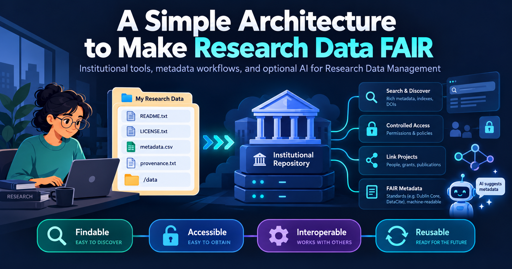
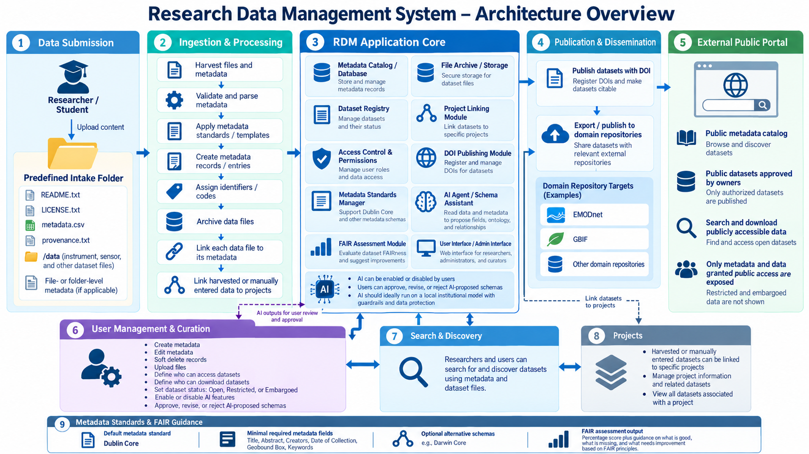
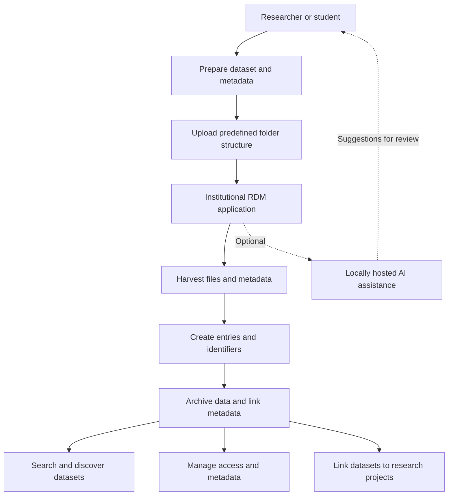

# Let's Be FAIR with Open Science 🔬



> **Making research data FAIR should be a natural part of the research workflow—not an additional burden.**

**Topics:** `architecture` · `science` · `software-development` · `FAIR` · `research-data-management` · `open-science`

A high-level proposal for a practical, institution-supported workflow that helps researchers make their data **Findable, Accessible, Interoperable, and Reusable (FAIR)**—with optional, carefully controlled AI assistance.

> [!NOTE]
> **Disclaimer:** I am not speaking on behalf of my employer. The opinions expressed here are my own.

## Contents

- [Background](#background)
- [The challenge](#the-challenge)
- [A more favorable scenario](#a-more-favorable-scenario)
- [Proposed solution](#proposed-solution)
  - [Prepare the dataset](#1-prepare-the-dataset)
  - [Dataset folder structure](#2-dataset-folder-structure)
  - [Workflow and architecture](#3-workflow-and-architecture)
- [Optional AI assistance](#optional-ai-assistance)
- [Metadata standards](#metadata-standards)
- [Pros and cons](#pros-and-cons)
- [Scope and considerations](#scope-and-considerations)
- [Conclusion](#conclusion)
- [References](#references)

## Background

This article assumes you already know the FAIR principles and have some experience with **Research Data Management (RDM)**—whether as a research software developer, PhD student, postdoc, master's student, data steward, or researcher.

As a software developer who has worked with RDM for almost nine years, I have learned a few lessons, especially while building solutions to support it.

Here, I want to present a simple solution architecture to help make research data FAIR, along with its trade-offs.

**FAIR is a set of guiding principles and best practices, not a prescribed framework, architecture, or technology.** It provides guidance for making research data:

| Principle | Meaning |
| --- | --- |
| **F — Findable** | Data and metadata can be discovered. |
| **A — Accessible** | Data and metadata can be accessed under clearly defined conditions. |
| **I — Interoperable** | Data and metadata can work with other systems and datasets. |
| **R — Reusable** | Data and metadata are documented well enough to support appropriate reuse. |

Every architecture has trade-offs. This is neither the only nor necessarily the best solution—just an approach I think could help improve FAIR practices and RDM.

## The challenge

One of the main complaints I hear from researchers and students is that making data FAIR adds more work to already busy schedules. They simply do not have enough time.

The good news is that **researchers should not have to carry the entire responsibility alone**. Universities and research institutes have a role in providing the infrastructure, support, and guidance required to make FAIR practices feasible. Researchers and students still have their part to play, especially in preparing accurate data and meaningful documentation.

## A more favorable scenario

FAIR best practices should become part of an institution's research culture, with IT providing the tools and infrastructure needed to support them.

## Proposed solution

Now comes the fun part—at least for me as a software developer. And yes, it involves AI, **but only as an optional component**.

I understand the concerns about using AI with confidential, sensitive, unpublished, or personally identifiable information. Below, I describe where I think it could help and how its use should be controlled.

### 1. Prepare the dataset

During the research process, prepare data and metadata using **open formats wherever possible**, such as CSV, or widely supported formats such as JPEG. If proprietary software was used, document its name and version so that others can understand how the data was created or processed.

Useful documentation files include:

| File | Purpose |
| --- | --- |
| `README.txt` | Explains the dataset, its contents, how it was created, and how to use it. |
| `LICENSE.txt` | Documents the terms under which the dataset may be used or shared, including restrictions. |
| `metadata.csv` | Serves as a data dictionary: variables, vocabularies, data types, and units. Other metadata—such as authors, dates, identifiers, and related publications—may also be needed. |
| `provenance.txt` | Describes the origin of the data: who, what, where, when, and how, including collection methods and any processing or transformations. |

> [!IMPORTANT]
> These filenames and formats are **practical recommendations, not FAIR requirements**. Providing these files alone does not make a dataset FAIR. Persistent identifiers, machine-readable metadata, findability, access arrangements, and suitable repository infrastructure also matter.

### 2. Dataset folder structure

One possible predefined structure is:

```text
dataset/
├── README.txt
├── LICENSE.txt
├── metadata.csv
├── provenance.txt
└── data/
    ├── measurement-01.csv
    ├── measurement-02.csv
    └── ...
```

Researchers or students place their documentation and data files, such as outputs from sensors or instruments, in this structure. Files and folders can also have their own metadata where applicable. The sample data filenames above are illustrative.

### 3. Workflow and architecture





The proposed workflow has five main stages:

1. **Prepare and upload the dataset.** The researcher or student uploads the dataset files, documentation, and `/data` directory in the agreed structure, or through an application interface.
2. **Harvest and organize the data.** The application automatically collects the files and metadata, creates corresponding entries, assigns unique identifiers, archives the data files, and links files to their metadata. Ideally, it also supports persistent identifiers, such as DOIs, where appropriate.
3. **Find and discover data.** Researchers and other users can search for and discover datasets and files based on the supplied metadata.
4. **Manage access and metadata.** Users can define whether data is open, restricted, or under embargo; determine who can access or download it; and create, edit, or delete metadata (using soft deletion when appropriate). Restricted access follows institutional policies and permissions.
5. **Link data to research projects.** Automatically harvested or manually entered datasets and metadata can be associated with specific research projects.
6. **Automate as much as possible:** For example, data generated by lab instruments or sensors could be automatically harvested and linked to existing metadata previously entered into the system by researchers and students.

## Optional AI assistance

AI should be **opt-in**, with users or institutions able to enable or disable it.

An AI agent could:

- Read the data and metadata and **suggest metadata fields**.
- Identify relevant **ontologies and controlled vocabularies**.
- Propose relationships between datasets, files, and metadata.
- Evaluate available information against established **FAIR assessment criteria**.
- Provide an indicative FAIR score or percentage, highlighting strengths, gaps, and recommended improvements.

**Human review remains essential.** Users should be able to approve, modify, or reject proposed schemas before they are applied. Any FAIR score should clearly explain its assessment method and be treated as guidance, not an absolute measure of FAIRness: some aspects cannot be assessed reliably by automation.

Ideally, the institution would provide a **locally hosted AI model** so that research data and metadata remain within controlled infrastructure, protected by appropriate security measures, access controls, and safeguards. This is especially important for confidential, sensitive, or unpublished research data.

## Metadata standards

The application should support established metadata standards, such as **Dublin Core**, with a minimum set of fields defined by the institution or research community.

| Field | Description |
| --- | --- |
| **Title** | Title of the dataset or file. |
| **Description / Abstract** | What the data contains and why it was collected. |
| **Creators** | People or organizations responsible for creating the data. |
| **Date of Collection** | When the data was collected. |
| **Geographic Coverage** | Geographic region covered, such as a bounding box, where relevant. |
| **Keywords** | Descriptive terms, preferably from controlled vocabularies. |
| **Identifier** | Unique identifier for the dataset or file. |
| **License and Access Rights** | Conditions for accessing, sharing, and reusing the data. |

Users should also be able to choose domain-specific metadata standards, such as **Darwin Core** for biodiversity data, based on their research needs.

## Pros and cons

### Advantages

- **Less repetitive work:** Automated harvesting can reduce manual metadata entry and dataset registration.
- **A consistent workflow:** Researchers prepare data and metadata and upload them through a predefined structure or user interface.
- **More time for research:** With institutional infrastructure handling routine tasks, researchers can focus more on their work.
- **Better support for FAIR practices:** Documentation, discovery, access management, and project linking can become part of a standard process.

Researchers would still need to prepare meaningful documentation and verify the accuracy of their data and metadata.

### Trade-offs

- **Reduced granularity:** A simplified metadata model may not capture all the details required by specific research communities.
- **Limited predefined relationships:** Some relationships between entities may require further modeling.

These limitations can be addressed by allowing projects to add more detailed metadata and define relationships that match their specific requirements.

## Scope and considerations

This is a **high-level architecture proposal**, not a complete technical design. Topics such as storage, archiving, backup strategies, security implementation, and infrastructure design are outside its scope.

The goal is to illustrate how a straightforward workflow, backed by institutional IT and optionally AI, could reduce manual effort while improving the findability, accessibility, interoperability, and reusability of research data.

## Conclusion

I have seen several applications with impressive features. But in my experience, many researchers and students already want to make their data FAIR. As IT professionals, we should give them **feasible, practical solutions**, not tools that create even more work.

Not all researchers have the same understanding of FAIR or access to the same resources, so institutions need to provide support, infrastructure, and guidance.

**FAIR practices should be a natural part of the research workflow—not an additional burden.**

## References

- [GO FAIR — FAIR Principles](https://www.go-fair.org/fair-principles/)

---

*An opinionated, high-level proposal for practical FAIR Research Data Management and Open Science.*
